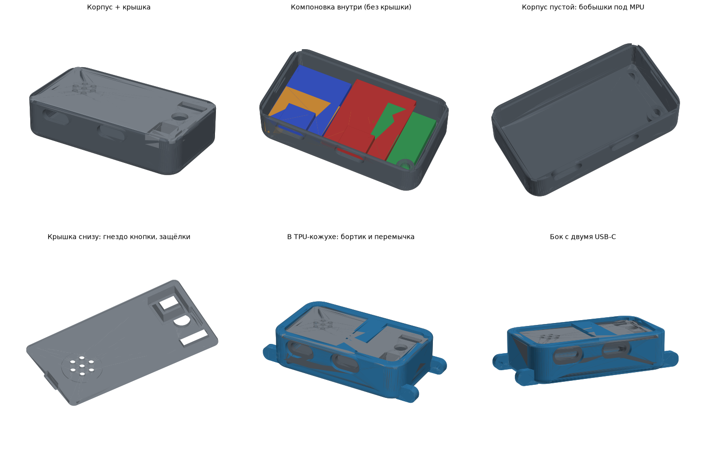
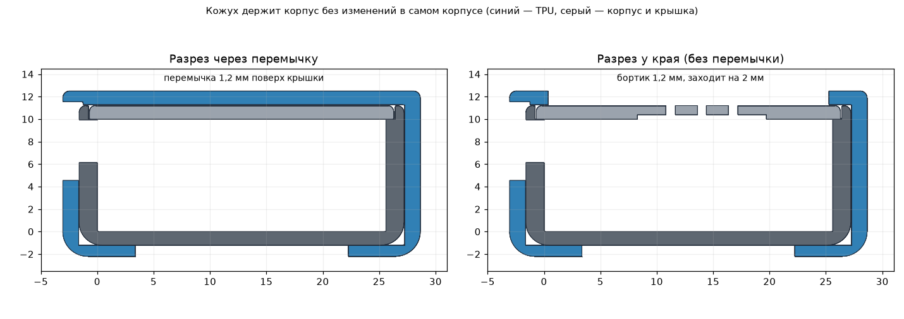

# Korgan Pod: компактный корпус + TPU-рукав



| Файл | Что это | Печать |
|---|---|---|
| `pod_case.step`, `STL/pod_case.stl` | корпус-«капсула» 52.9 × 28.8 × 12.4 мм | PETG/PLA, дном вниз, 0.12–0.16 мм, без поддержек |
| `pod_lid.step`, `STL/pod_lid.stl` | крышка: кнопка, LED, выключатель, решётка зуммера, 2 защёлки | PETG, лицом вниз |
| `pod_sleeve.step`, `STL/pod_sleeve.stl` | рукав с ушками под стандартные шпильки 20 мм (66.2 × 31.7 × 14.7 мм) | **TPU 95A**, дном вниз, ушки 100 % заполнения |
| `pod_sleeve_loop.step`, `STL/pod_sleeve_loop.stl` | тот же рукав с прорезями под ленту-липучку 25 мм (69.0 × 31.7 × 14.7 мм) | TPU 95A, дном вниз |
| `pod_sleeve_nobridge.step`, `STL/pod_sleeve_nobridge.stl` | рукав под шпильки **без перемычки** (вариант 3) | TPU 95A, дном вниз, без поддержек |
| `pod_sleeve_loop_nobridge.step`, `STL/pod_sleeve_loop_nobridge.stl` | рукав под липучку **без перемычки** (вариант 3) | TPU 95A, дном вниз, без поддержек |
| `pod_assembly.step` | сборка с болванками плат для проверки | — |
| `korgan_pod.py` | параметрический исходник (CadQuery) | `python models/korgan_pod.py` |

Старые `case.step` / `lid.step` не тронуты.

Подробные настройки печати и выбор пластика для каждой детали — в [PRINT_GUIDE.md](PRINT_GUIDE.md).

## Компоновка (2 слоя)

```
верх: [ ESP32-C3 SuperMini ][ TP4056 Type-C ][ кнопка · LED · выключатель ]
низ:  [      АКБ 30×15×5        ]      [ MPU6050 на 2 втулках M2 (вплавл.) ]
          USB-C ESP ↑       USB-C зарядки ↑   (оба порта на одной длинной стороне)
```

- **MPU6050**: две бобышки Ø5.6 мм высотой 2.4 мм под вплавляемые латунные втулки M2 (по умолчанию
  длина 3 мм, наружный Ø3.2 мм → отверстие Ø3.0 глубиной 3.2 мм). Плата крепится винтами M2×4.
  Размеры втулки заданы в `korgan_pod.py` (`INSERT_OD`, `INSERT_L`) — измерь свои и перегенерируй.
  Втулка длиннее 3 мм не поместится: MPU упрётся в плату зарядки, скрипт об этом предупредит.
  Других рёбер, стоек и опор внутри корпуса нет.
  Пины не впаивать, провода паять прямо в плату, так ниже.
- **Платы ESP и зарядки** лежат на АКБ через вспененный двусторонний скотч 0.4 мм (на нём основана компоновка).
- **Размеры минимальные:** запаса нет (`EXTRA_L`, `EXTRA_W`, `EXTRA_H` в `korgan_pod.py` равны 0). Чтобы корпус был просторнее, поставь, например, 5 мм в нужное измерение.
- **Отверстия из старой модели**: USB-C зарядки, кнопка, LED Ø5, прямоугольное отверстие выключателя 8.4×3.4 (тумблер 8×3 + зазор 0.2 мм), Ø12 под зуммер (теперь решётка).
  Кнопка, LED и выключатель стоят в ряд поперёк крышки, между краями отверстий около 3 мм.
  **Новое**: USB-C для ESP32-C3.

## Что купить / заменить

| Деталь | Почему |
|---|---|
| Тактовая кнопка **6×6×7** или 6×6×8.5 | корпус вклеивается в квадратное гнездо 7×7 под крышкой, шток выходит в квадратное отверстие 5.5×5.5 |
| **Пьезодиск Ø12** (вклеить в выемку под решёткой) | обычный зуммер 12×9.5 мм в тонкий корпус не влезет; прошивка и так шлёт ШИМ 1 кГц |
| Светодиод 5 мм (или 3 мм → `LED_D = 3.1`) | |
| Ползунковый выключатель SS12D00 | тумблер 8×3 мм в прямоугольное отверстие 8.4×3.4 |

## Фиксация корпуса в кожухе



Корпус не меняется: держит только кожух.

- **Толстый бортик по периметру.** 1.2 мм над крышкой (раньше 0.5 мм — тонкий TPU выворачивался,
  и корпус выскакивал), заходит на 2 мм от края. Отверстия крышки остаются открытыми.
- **Два варианта рукава** ([картинка](preview/sleeve_variants.png)), печатай любой:
  - **Вариант 2 — с перемычкой** (`pod_sleeve.stl`, `pod_sleeve_loop.stl`). Перемычка 8 мм поперёк крышки
    между решёткой зуммера и кнопкой. В STL уже лежит **отрывная подпорка** под перемычкой
    (второе тело, стоит на столе через окно в дне, зазор 0.4 мм) — перемычка не провиснет.
    После печати подпорку вытащить через окно в дне. Держит сильнее всего.
  - **Вариант 3 — без перемычки** (`*_nobridge.stl`). Ровное окно со скруглёнными углами и бортиком
    2.6 мм одинаковой ширины по всему периметру (шире нельзя — закроет кнопку), плюс вырез у тумблера.
    Печатается без поддержек и мостов; вставлять корпус проще, держит слабее варианта 2.
- **Вырез у тумблера.** В торцевом бортике напротив тумблера убран кусок 6.4 мм шириной, чтобы палец
  доставал рычажок в крайнем положении. Стенка кожуха под вырезом целая (`SW_NOTCH_MARGIN`).
- **Плотная посадка:** зазор 0.05 мм на сторону (было 0.15), TPU обжимает корпус.
- Корпус вставляется так: один короткий край под бортик, затем вдавить второй край под бортик и
  перемычку — TPU растянется.

## Ремешок## Ремешок

Подходит любой ремешок с креплением **20 мм** на пружинных шпильках (липучка, силикон, NATO).
Ушки толщиной 3 мм, отверстия под шпильку Ø1.1 мм глухие, глубиной 1.8 мм.
Удобнее всего шпильки с рычажком (quick release): их можно снять без инструмента.
Если шпилька выскакивает, уменьши `BAR_HOLE` до 1.0; если не встаёт, увеличь до 1.2.

**Вариант с лентой-липучкой** (`pod_sleeve_loop`, [превью](preview/pod_sleeve_loop.png)): эластичная лента 25 мм
с пряжкой (например, «стяжки на липучке» 25 × 250 мм) продевается в прорезь на одном конце рукава,
проходит под капсулой, выходит через вторую прорезь и застёгивается на запястье.
Прорезь 26.5 × 3.2 мм: под другую ленту поменяй `SLOT_W` (ширина + 1.5) и `SLOT_T` (толщина + 1).

## Подгонка

Все размеры в начале `korgan_pod.py`. Перед печатью измерь штангенциркулем:
`MPU_HOLE_SPACING` (расстояние между отверстиями GY-521, по умолчанию 15.24),
толщину плат (`ESP[2]`, `CHG[2]`) и с какой стороны у зарядки USB-C.
Если крышка туго защёлкивается, уменьши `SNAP_BUMP` (0.35 → 0.25).
